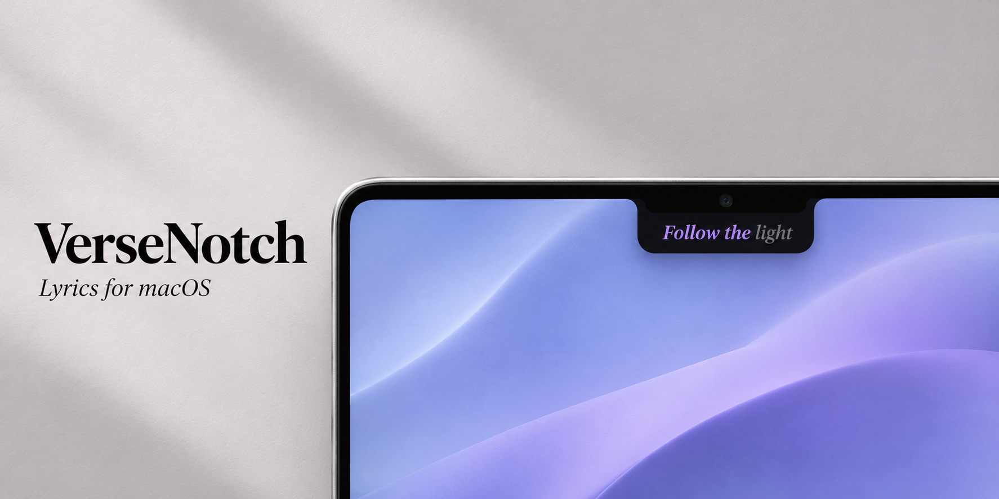
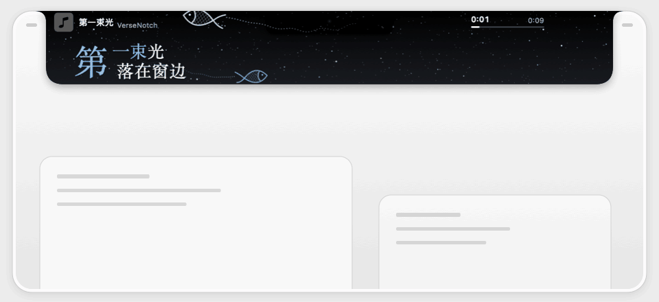
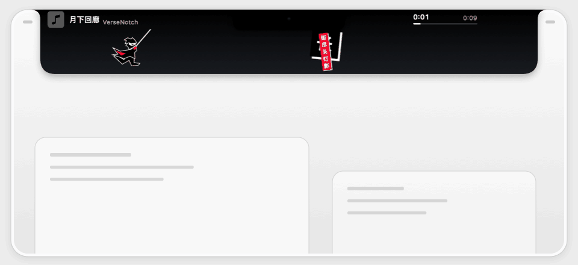

# VerseNotch

[简体中文](README.md)

VerseNotch is a native macOS menu bar music player that shows synced lyrics at the top of your screen.

[Website](https://versenotch.com/en/) · [Mac App Store](https://apps.apple.com/app/versenotch/id0000000000) · [Quick start](#quick-start) · [Features](#features) · [Demos](#demos) · [Creating plugins](#creating-plugins)

## Overview

Put on a song you love while you do something you enjoy. Glance up to catch the line being sung, and hum along if you feel like it. It’s a small pleasure that can make an ordinary day a little brighter.

VerseNotch keeps the lyrics at the top of the screen. With word-level timing, the lyrics light up as they’re sung. With line-level timing, they advance one line at a time. Some themes also offer holographic lyrics on the desktop. On displays without a notch, lyrics can appear just below the menu bar.

## Quick start

1. On a Mac running **macOS 14 or later**, visit the [VerseNotch website](https://versenotch.com/en/) or open the [Mac App Store](https://apps.apple.com/app/versenotch/id0000000000).
2. Install and open VerseNotch. In the player and playlists view, import local music or connect to Navidrome, then play a track.
3. Open Appearance to choose a lyric theme and adjust the overlay size and material. The menu bar waveform still gives you playback controls after you close the main window.

## Features

| Feature | What you can do |
| --- | --- |
| Synced lyrics | Follow lyrics line by line or word by word at the top of your screen. Highlights stay at the current position when you pause. |
| Notch overlay and holographic lyrics | Adjust the overlay width, height, material, and resonance. Switch supported themes to holographic mode. |
| Local library and Navidrome | Import local music or browse and play music from a self-hosted Navidrome library. |
| Local lyric files | Attach a UTF-8 LRC file or VerseNotch v1 JSON to the current track from the menu bar and adjust lyric timing. |
| Lyric-style plugins | Import a `.vnplugin` lyric style in the plugin library, preview it, and apply it. |

## Demos

| Fish in a Sea of Stars | Phantom Thief's Corridor |
| :---: | :---: |
|  |  |

## Creating plugins

Use the [lyric-style authoring skill](https://github.com/MolMind/verse-notch-skills/tree/lyric-style-v1.0.0/skills/versenotch-lyric-style) to create, validate, and package a `.vnplugin` file. The [lyric-style documentation](https://versenotch.com/en/docs/plugins/lyric-style) covers package rules, compatibility, and where to upload plugins. The [VerseNotch plugin skills repository](https://github.com/MolMind/verse-notch-skills) also provides design guides for music service login, lyrics and artwork retrieval, overlay styles, playback order, and audio presets.

## Releases

VerseNotch is made by [MolMind](https://github.com/MolMind). Product information and documentation are available on the [VerseNotch website](https://versenotch.com/en/). Install and update the App Store edition through the Mac App Store.
