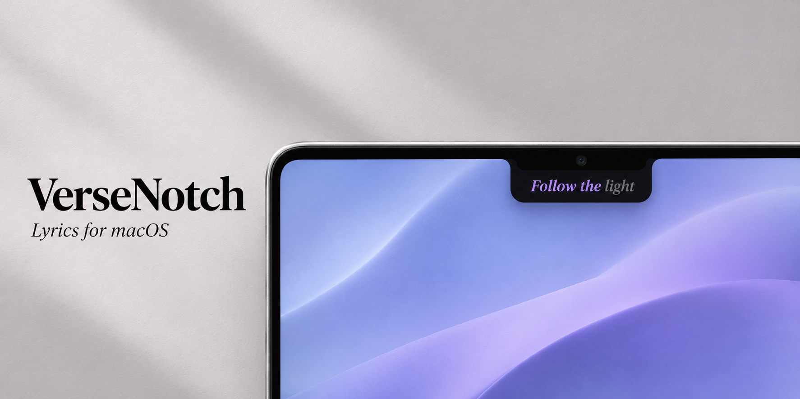

# VerseNotch

VerseNotch 是一款原生 macOS 菜单栏音乐播放器。播放音乐时，同步歌词显示在屏幕顶部。

[官网](https://versenotch.com/) · [Mac App Store](https://apps.apple.com/app/versenotch/id0000000000) · [快速开始](#快速开始) · [主要功能](#主要功能) · [制作插件](#制作插件)

## 概览

边工作边听歌时，可以在屏幕顶部看歌词，不必切回播放器。歌词有逐字时间时，当前字词会随演唱点亮。只有逐行时间时，歌词按句切换。支持的主题还可以切换为桌面全息歌词。无刘海的显示器也可以在菜单栏下方显示歌词。

## 快速开始

1. 确认 Mac 运行 **macOS 14 或更高版本**，前往 [VerseNotch 官网](https://versenotch.com/)，或打开 [Mac App Store](https://apps.apple.com/app/versenotch/id0000000000)。
2. 安装并打开 VerseNotch。在「唱机与歌单」中导入本地音乐或连接 Navidrome，然后选一首歌播放。
3. 打开「外观」选择歌词主题、浮窗尺寸和材质。关闭主窗口后，仍可通过菜单栏的波形图标控制播放。

## 主要功能

| 功能 | 使用方式 |
| --- | --- |
| 同步歌词 | 在屏幕顶部查看逐行或逐字歌词，暂停时高亮停在当前位置 |
| 灵动浮窗与全息歌词 | 调整浮窗宽高、材质和音乐共振。在支持的歌词主题中开启全息模式 |
| 本地曲库与 Navidrome | 导入本地音乐，或浏览并播放自建 Navidrome 曲库 |
| 本地歌词绑定 | 在菜单栏为当前曲目绑定 UTF-8 LRC 或 VerseNotch v1 JSON，并校准歌词时间 |
| 歌词样式插件 | 在「插件库」从文件导入 `.vnplugin` 歌词样式，预览后应用 |

## 制作插件

用[歌词样式制作技能](https://github.com/MolMind/verse-notch-skills/tree/lyric-style-v1.0.0/skills/versenotch-lyric-style)制作、校验和打包 `.vnplugin`。从[官网歌词样式文档](https://versenotch.com/docs/plugins/lyric-style)查看规则、兼容版本和投稿入口。公开技能目录还提供平台登录、歌词与封面获取、浮窗样式、播放顺序和音质调节的设计技能。 [VerseNotch 插件技能](https://github.com/MolMind/verse-notch-skills)

## 版本与发行

VerseNotch 由 [MolMind](https://github.com/MolMind) 制作。产品介绍和使用文档见 [VerseNotch 官网](https://versenotch.com/)，商店版通过 Mac App Store 安装和更新。
